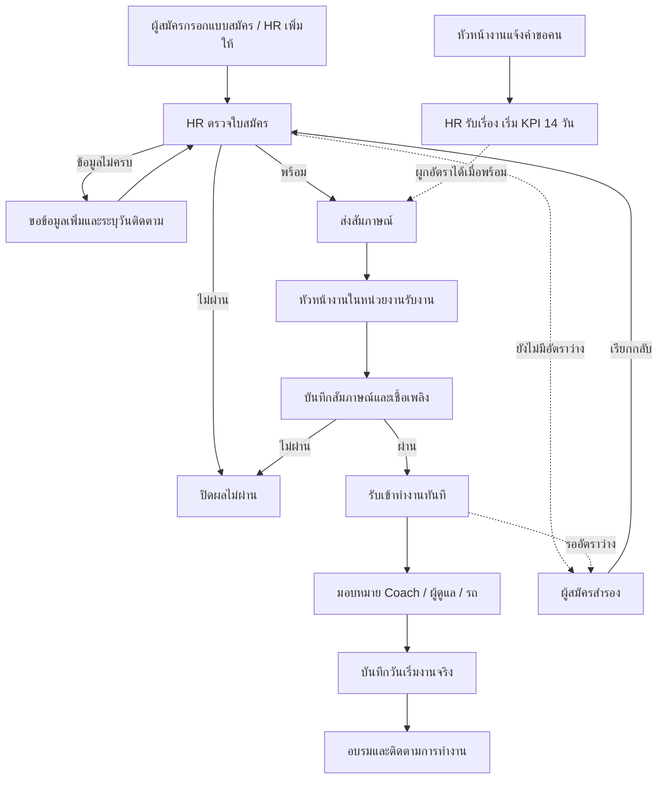
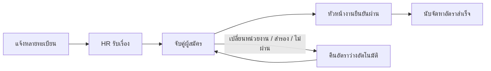

# คู่มือ Recruitment System V4.0.0

## ภาพรวม

ไม่จำเป็นต้องมีคำขอคนก่อนรับสมัคร ผู้สัมภาษณ์กับหัวหน้าผู้ดูแลหลังเริ่มงานเป็นคนละคนได้

## เริ่มใช้งาน

เปิดโดเมนหลัก Login ด้วยอีเมลและรหัสผ่านที่เจ้าของสร้างไว้ ระบบแสดงเมนูตาม Role เปิดภาพรวมเพื่อดูงานค้าง กดรายการเพื่อทำขั้นถัดไป ทุกหน้ามีปุ่มแบบฟอร์มสมัครงานสำหรับเปิดลิงก์ให้ผู้สมัคร

วันที่ใช้ `dd/mm/yyyy` เป็น ค.ศ. เช่น 19/10/2026 ช่องบังคับมี * สีแดง ถ้าขึ้น “ข้อมูลเปลี่ยนแล้ว” ให้เปิดรายการใหม่ก่อนแก้ไข เพราะมีผู้ใช้อื่นบันทึกไปก่อนแล้ว

## HR: รับใบสมัครจนส่งสัมภาษณ์

1. ผู้สมัครใช้ลิงก์ `https://โดเมน/#apply` หรือ HR กด “เพิ่มผู้สมัคร”
2. กรอกข้อมูลส่วนตัว หน่วยงาน และตำแหน่ง คนขับต้องระบุรถ/ใบขับขี่ เด็กติดรถไม่บังคับ
3. ในผู้สมัคร → เปิดรายการ → HR คัดกรอง
4. เลือกส่งสัมภาษณ์ / ขอข้อมูลเพิ่ม / ไม่ผ่าน หากขอข้อมูลเพิ่มต้องมีเหตุผลและวันติดตาม
5. หากพบใบสมัครซ้ำ ให้ตรวจประวัติและใส่เหตุผลยืนยัน หากอายุต่ำกว่าเกณฑ์เดิม (คนขับ 25 / เด็กติดรถ 18) ต้องมีเหตุผลข้อยกเว้น
6. ผูกคำขอคนได้ถ้ามีอัตราว่างที่หน่วยงาน/ตำแหน่งตรงกัน ไม่ต้องรอคำขอเพื่อส่งสัมภาษณ์

## หัวหน้างาน: สัมภาษณ์

1. ผู้สมัคร → กรอง “รอสัมภาษณ์” → เปิดรายการ
2. กด “รับงานสัมภาษณ์” ทำได้เฉพาะหน่วยงานที่รับผิดชอบ
3. ให้คะแนน 1–5 กรอกเชื้อเพลิงและบันทึก ผลทดลองขับไม่บังคับ หากบันทึกทดลองขับไม่ผ่านจะยืนยันสัมภาษณ์ผ่านไม่ได้
4. เก็บแบบร่างได้ หรือยืนยันผล เมื่อยืนยัน “ผ่าน” จะรับเข้าทำงานทันที และปิดอัตราที่ผูกอยู่
5. หากต้องเปลี่ยนคนสัมภาษณ์ให้คืนงานก่อน ผู้รับงานคนใหม่รับคิวต่อได้ (แบบร่างที่ยังไม่ส่งจะถูกล้างเมื่อคืนคิว)

## คำขอคน

หัวหน้างานกด “แจ้งขอคน” เพิ่มทะเบียน/รถบริษัทหรือรถร่วม/ตำแหน่งทีละรายการได้หลายคัน หากขอคนขับและเด็กติดรถให้เพิ่มแยกสองรายการ HR กดรับเรื่องก่อนจับคู่ คำขอจะแสดงรายการล่าสุดสูงสุด 200 คำขอ

KPI 14 วันนับเฉพาะคนขับ 1 คน = 1 อัตรา เริ่มเมื่อ HR รับเรื่อง จบเมื่อหัวหน้างานยืนยันผ่าน เด็กติดรถไม่รวมใน KPI นี้

## สำรอง เปลี่ยนหน่วยงาน และปิดเคส

- สำรอง: HR เปิดรายการ → สำรอง → ระบุเหตุผล ระบบคืนอัตราว่างแต่เก็บผลเดิม
- เรียกกลับ: ผู้สมัครสำรอง → เรียกกลับ → เลือกสัมภาษณ์ใหม่หรือใช้ผลเดิมเป็นแบบร่าง → HR ส่งสัมภาษณ์ → หัวหน้างานยืนยันรอบใหม่
- เปลี่ยนหน่วยงาน: HR แก้ข้อมูล → เปลี่ยนหน่วยงานรับจริงพร้อมเหตุผล ระบบเก็บหน่วยงานสมัครเดิม ปลดคำขอเดิม และคืนคิวให้หน่วยงานใหม่หากยังสัมภาษณ์ไม่เสร็จ
- ปิดเคส: HR เลือกถอนตัว / ไม่มาเริ่มงาน / ยกเลิกรับ พร้อมเหตุผล ทำก่อนเริ่มงานจริง หลังเริ่มงานให้ใช้สถานะลาออกแทน

## รับเข้าทำงานและอบรม

HR/หัวหน้างานในหน่วยงาน/ผู้จัดการจัดส่ง มอบหมาย Coach, หัวหน้าผู้ดูแล และทะเบียน/รถ หากผูกคำขอไว้ทะเบียนและรถต้องตรงคำขอ

กรอกกำหนดเริ่มงานเพื่อวางแผน และกรอกวันเริ่มงานจริงเมื่อมาทำงานแล้ว จากนั้นเปิดบันทึกอบรมได้ เลือกหัวข้อ วันอบรม และผลผ่าน/ไม่ผ่าน เพิ่มหัวข้อใหม่ตามตำแหน่ง/หน่วยงานได้ วันที่อบรมต้องไม่ก่อนเริ่มงานและไม่เป็นอนาคต แก้ผลเดิมต้องมีเหตุผล

| Role | สิทธิ์แก้ผลอบรม |
|---|---|
| Admin / HR / ผู้จัดการจัดส่ง | ทุกหน่วยงาน ทุกประเภท |
| หัวหน้างาน | ทุกประเภท เฉพาะหน่วยงานตน |
| Driver Coach | ประเภท Coach เฉพาะพนักงานที่มอบหมายให้ตน |
| Safety | ประเภท Safety ทุกหน่วยงาน |
| Driver Trainer | ประเภท Driver Trainer ทุกหน่วยงาน |

Coach/Safety/Trainer/ผู้จัดการจัดส่งเห็นพนักงานที่รับแล้วทุกคน แต่เอกสารและเลขบัตร/เลขใบขับขี่ไม่แสดงแก่กลุ่มอบรมเหล่านี้

KPI 90 วัน: ผู้เริ่มงานในวันนี้ย้อนหลังรวม 90 วัน เป็นฐานคำนวณ ใช้จำนวนที่ยังทำงานอยู่หารทั้งหมดในช่วง เป้าหมาย 90% **ไม่ต้องรอทำงานครบ 90 วัน และไม่ใช้ผลอบรมตัดสิน** กรอกวันลาออกให้ถูกต้องเพื่อให้สถิติอัปเดต

## Admin

สร้าง Auth user ใน Supabase ก่อน แล้วตั้งค่าระบบ → เพิ่มสิทธิ์ด้วยอีเมลเดียวกัน กำหนดชื่อ Role และหน่วยงาน ห้ามปิด/ลดสิทธิ์ Admin ของตัวเอง

ตั้งลิงก์ Google Sheet/Drive/Form เดิมให้เปิดตรวจหลังบ้านได้ เปิดสมัครออนไลน์เมื่อพร้อม ลิงก์ Google เดิมเป็นแหล่งอ้างอิง ไม่มีการซิงก์ข้อมูลเข้า Supabase โดยอัตโนมัติ

ดาวน์โหลดสำรอง JSON ก่อนรีเซ็ตข้อมูลทดลอง ตรวจจำนวนแล้วพิมพ์ `RESET RECRUITMENT` ระบบเก็บผู้ใช้ หน่วยงาน หัวข้ออบรมและตั้งค่าไว้ หากมีเอกสารแนบจะไม่ให้รีเซ็ต ต้องให้เจ้าของสำรองและจัดการเอกสารก่อน JSON ไม่รวมเนื้อไฟล์เอกสาร

## รอบทดสอบก่อนเปิดจริง

1. ใช้ HR เพิ่มคนขับโดยไม่มีคำขอคน → ส่งสัมภาษณ์
2. ใช้หัวหน้างานรับคิว → เก็บแบบร่าง → ยืนยันผ่านโดยไม่กรอกผลทดลองขับ
3. HR มอบหมาย Coach/หัวหน้า → กรอกวันเริ่มงานจริง
4. Coach ที่ได้รับมอบหมายบันทึกผล Coach ได้ ผู้ไม่ได้รับมอบหมายต้องไม่ได้
5. Safety/Trainer บันทึกประเภทตนได้ทุกหน่วยงาน หัวหน้างานต่างหน่วยงานต้องแก้ไม่ได้
6. สร้างคำขอหลายทะเบียน → HR รับ → ผูกผู้สมัคร → เปลี่ยนหน่วยงาน ตรวจว่าอัตราเก่าว่าง
7. ทดลองสำรอง/เรียกกลับ/ปิดเคส และตรวจประวัติ
8. ทดสอบ upload PDF/JPG, logout, forgot password และมือถือกับ Supabase/Vercel จริง
