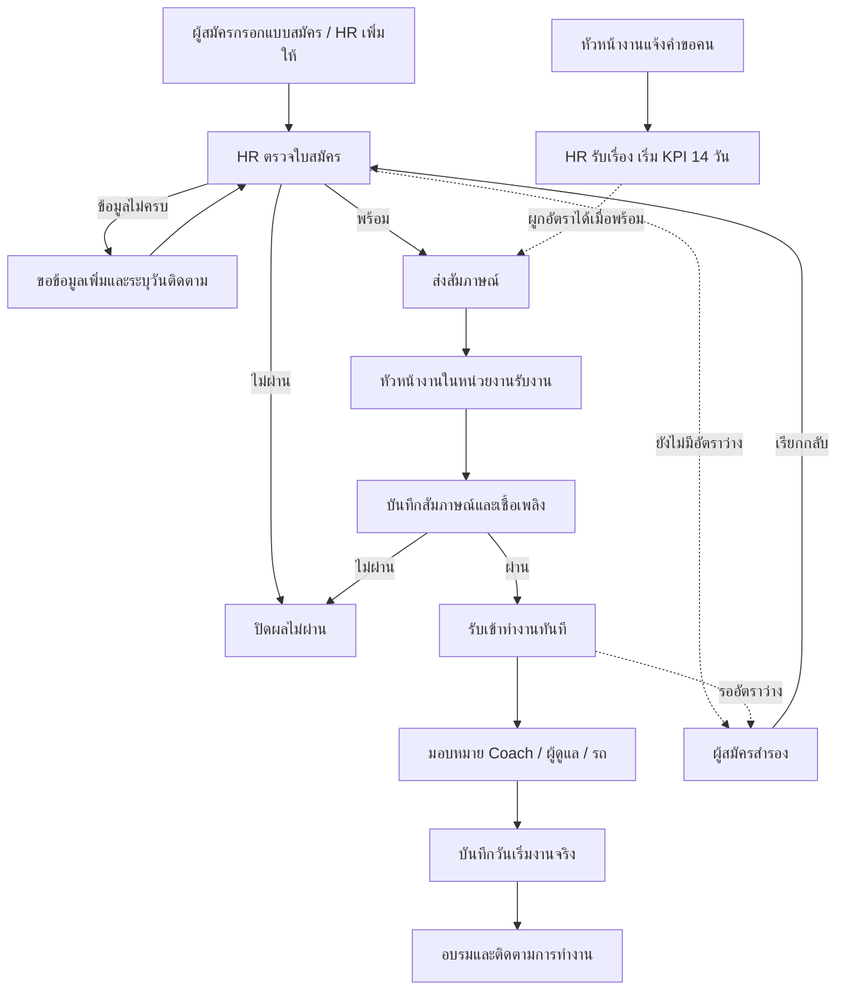
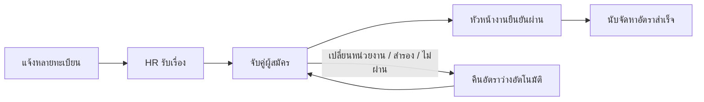

## V4.10.0: ภาพและไฟล์แนบใน Google Drive

- ท้ายใบสมัครมีส่วนเลือก JPG/JPEG, PNG, PDF แบบไม่บังคับ สูงสุด 10 ไฟล์ต่อครั้ง ไฟล์ละไม่เกิน 10 MB
- เปิดใช้หลังเจ้าของ Deploy Google Drive Bridge และตั้งค่าเชื่อมต่อแล้ว หากยังไม่เปิด ผู้สมัครส่งใบสมัครโดยไม่แนบไฟล์ได้ตามเดิม
- เปิดรายละเอียด → เอกสารแนบ: รูปโหลดแสดงอัตโนมัติ PDF กดเปิดดูในเว็บหรือดาวน์โหลดได้
- Admin/HR แนบเพิ่มในหน้ารายละเอียดได้ ไฟล์ไปอยู่โฟลเดอร์รหัสผู้สมัครเดิม Supervisor ดูตามขอบเขตหน่วยงานและ Driver Coach ดูตามสิทธิ์พนักงานที่รับเข้า/เริ่มงานแล้วเดิม
- หากส่งไฟล์ไม่สำเร็จ ให้ลองเฉพาะรายการที่ค้าง ไม่ส่งใบสมัครซ้ำ รายการอัปโหลดค้างที่มีไฟล์ใน Drive แล้วให้ Admin/HR กดตรวจไฟล์ที่ส่งค้าง
- ระบบไม่เปิด Drive เป็นสาธารณะ และไม่ลบไฟล์อัตโนมัติ การรีเซ็ตถูกบล็อกหากยังมีไฟล์หรือรายการส่งค้าง ต้องให้ผู้ดูแลจัดการอย่างรอบคอบก่อน
- คู่มือ Deploy อยู่ที่ integrations/google-drive/SETUP-TH.md

## อัปเดต V4.9.0: ดูว่าแต่ละคนถึงไหนแล้ว

- เมนูผู้สมัคร: ค้นชื่อ โทรศัพท์ หรือรหัส แล้วดูคอลัมน์ “ขั้นตอนปัจจุบัน”, “รอผู้รับผิดชอบ” และ “วันนัดถัดไป” ได้ทันที รหัสอยู่ใต้ชื่อ ส่วนข้อมูลอายุ/รถ/วันที่สมัครยังอยู่ในตารางที่เลื่อนแนวนอนได้
- ตัวกรอง “ขั้นตอนปัจจุบัน” แยกรอรับงานสัมภาษณ์, อยู่ระหว่างสัมภาษณ์, รอส่งมอบ, รอกำหนดวัน, นัดวันนี้, เลยวันนัด, นัดล่วงหน้า, ทำงานอยู่ และลาออกแล้ว
- เปิดรายละเอียด: ด้านบนแสดงขั้นตอน ผู้รับผิดชอบ วันติดตาม/วันเริ่มงาน สิ่งที่รอ และเหตุการณ์ล่าสุด พร้อมปุ่มทำงานถัดไปตามสิทธิ์
- HR/Admin: หน้างานเพิ่มติดตามสัมภาษณ์ รอส่งมอบ รอกำหนดวัน นัดเริ่มงานวันนี้ เลยวันนัด และนัดล่วงหน้า กด “ดูรายการทั้งหมด” จะเปิดรายการพร้อมตัวกรองคิวเดียวกัน
- Driver Coach: คิวหลักแสดงเฉพาะผู้ที่มอบหมายให้ตนเองและยังไม่บันทึกผลทดลองขับ กดเปิดรายชื่อพนักงานเพื่อดูรายการอื่นตามสิทธิ์เดิมได้
- “เลยวันนัด” เป็นการแจ้งให้ติดตาม ไม่ใช่การตัดสินว่าไม่มาเริ่มงาน HR ต้องตรวจสอบและกดบันทึกเอง
- วันที่เทียบวันปัจจุบันของ Asia/Bangkok และแสดง dd/mm/yyyy (ค.ศ.) หากเปิดหน้าค้างข้ามวันให้กดรีเฟรช
- ฟังก์ชันนี้ใช้ข้อมูลเดิม ไม่เพิ่มขั้นตอนกรอก ไม่เปลี่ยนผลสัมภาษณ์หรือสิทธิ์ใคร และไม่ล้างข้อมูล

## อัปเดต V4.8.0

- ทุกตารางมีคอลัมน์ลำดับด้านซ้าย รายชื่อผู้สมัครนับต่อเนื่องเมื่อเปลี่ยนหน้า
- ตั้งค่า “การรับสมัครออนไลน์” เหลือเฉพาะเปิด/ปิดรับสมัคร ตัดช่องและลิงก์ Google เดิมออก
- หน้าตั้งค่าแสดงประวัติ 10 รายการล่าสุด โดยไม่ลบประวัติเก่า
- ตัดเมนูรหัสผ่านออกจาก Sidebar การตั้งรหัสผ่านผ่านลิงก์กู้คืนยังทำงานตามเดิม
- ปรับปุ่มท้าย modal ระยะหน่วยงาน การตัดข้อความ และตารางเลื่อนแนวนอนให้รองรับมือถือ

## หน้ารายการและรายละเอียด V4.7.0

- ตารางผู้สมัครแยกคอลัมน์รหัส ชื่อ วันที่สมัคร ตำแหน่ง อายุ/เกณฑ์ ประเภทรถ หน่วยงาน สถานะ และปุ่มรายละเอียด
- กดหัวตารางชื่อ วันที่สมัคร อายุ หรือหน่วยงานเพื่อเรียงทั้งชุดข้อมูล เลือก 10/20/30/50/100 รายการต่อหน้า และกดหน้าแรก/ก่อนหน้า/ถัดไป/สุดท้ายได้
- กดค้นหาและตัวกรองเพื่อค้นชื่อ โทรศัพท์ รหัส หน่วยงาน สถานะ ตำแหน่ง ประเภทรถ ช่วงอายุ และช่วงวันที่สมัคร
- อายุคิดตามวันเกิด ณ วันปัจจุบัน (Asia/Bangkok) คนขับเกณฑ์ 25 ปี เด็กติดรถ 18 ปี ป้ายต่ำกว่าเกณฑ์ไม่ได้ห้ามรับอัตโนมัติ ยังคงเหตุผลอนุโลมตาม workflow เดิม
- Driver Coach ไม่ได้รับวันเกิดหรืออายุจากหน้ารายการ และไม่มีตัวกรองอายุ ขอบเขตหน่วยงานและสิทธิ์แก้ไขยังตรวจที่ฐานข้อมูล
- ข้อมูลทั่วไปแบ่งหมวดส่วนบุคคล ติดต่อ/การขับรถ บัตรประชาชน ใบขับขี่ หน่วยงาน ความพร้อม/ประสบการณ์ โดยแสดงช่องว่างเป็น —
- Sidebar ขยายแล้วเลื่อนพื้นที่เนื้อหาให้ ไม่บังตาราง และยังย่ออัตโนมัติตามเดิม
- หลังล้างทั้งระบบให้ Admin เพิ่มหน่วยงานและตั้งค่าเปิดรับสมัครก่อน HR จึงเริ่มรับข้อมูลใหม่ได้ ส่วนหัวข้ออบรมเพิ่มโดย HR/Supervisor ตามสิทธิ์

## อัปเดตหน้าจอ V4.6.0

- ใช้สีเขียวเป็นสีหลัก ลิงก์และการกระทำรองใช้สีน้ำเงิน
- หน้าแรกแสดงคิวงานตามบทบาท กดชื่อเพื่อเปิดแท็บที่เกี่ยวข้องได้ทันที แสดงตัวอย่าง 5 รายการล่าสุดต่อกลุ่ม กดดูทั้งหมดเพื่อค้นหาและเปลี่ยนหน้า
- กลุ่มงานไม่มีรายการและ KPI อยู่ในส่วนพับเก็บ ส่วน PIN สำหรับ HR/Admin ยังแสดงตามเดิม
- รายละเอียดแบ่งแท็บตามข้อมูลและสิทธิ์: ข้อมูลทั่วไป, สัมภาษณ์, ส่งมอบ/เริ่มงาน, ทดลองขับ, การอบรม และประวัติ
- แถบขั้นตอนแสดงความคืบหน้าการรับสมัคร ส่วนผลทดลองขับและอบรมแสดงแยก ไม่เป็นเงื่อนไขรับเข้าทำงานเพิ่ม
- ปุ่มงานถัดไปเปิดฟอร์มที่มีสิทธิ์ทำได้จริง การโอน/คืนงานหรือการกระทำที่ต้องตรวจข้อมูลก่อนจะพาไปแท็บที่เกี่ยวข้อง
- ปุ่มจัดการใบสมัครรวมการแก้ไข ติดต่อ สำรอง เรียกกลับ และปิดเคส ฟอร์มยังเปิดเป็น modal และบันทึกสำเร็จแล้วคงแท็บเดิม
- มือถือใช้การ์ดรายชื่อแทนตาราง และเลื่อนแถบแท็บแนวนอนได้ รองรับคีย์บอร์ดปุ่มลูกศร Home/End สำหรับสลับแท็บ
- ไม่เปลี่ยนโครงสร้างฐานข้อมูล ไม่ต้องรัน SQL และไม่ล้างข้อมูลเดิม

## อัปเดตหน้าจอ V4.5.0

- หน้าเข้าสู่ระบบมีเฉพาะอีเมล รหัสผ่าน และปุ่มเข้าสู่ระบบ ส่วนลิงก์ใบสมัครยังเปิดจากเมนูในระบบหรือส่งลิงก์ #apply ให้ผู้สมัครได้
- หน้าแรกแยกตามงาน: Admin จัดการระบบ, HR สรรหาและเริ่มงาน, Supervisor สัมภาษณ์/ส่งมอบ/อบรม, Driver Coach ดูพนักงานและบันทึกผลทดลองขับที่ได้รับมอบหมาย
- เมนูซ้ายย่ออัตโนมัติบนคอมพิวเตอร์ จ่อเมาส์หรือใช้คีย์บอร์ดเพื่อขยาย บนมือถือแตะปุ่มเมนู
- ฟอร์มบันทึกข้อมูลเปิดจากปุ่มในแต่ละส่วน แล้วกรอกในหน้าต่าง modal กดบันทึกเพื่อยืนยัน หรือยกเลิกเพื่อออกโดยไม่บันทึก
- ช่องค้นหา/ตัวกรองยังอยู่หน้ารายการเพื่อค้นหาได้ทันที ใบสมัครสาธารณะยังเป็นหน้าฟอร์มเต็มที่รองรับมือถือ
- การย้ายฟอร์มไม่เปลี่ยนขอบเขตสิทธิ์หรือขั้นตอนบังคับ HR ยังเป็นผู้บันทึกเริ่มงาน

# อัปเดต V4.4.0 — คำขอคนและบทบาท

หัวข้อ “แจ้งขอคน” เลือกได้สองค่า: ทดแทนอัตรากำลังเดิม / ขออัตรากำลังเพิ่ม หัวข้อคำขอเดิมยังแสดงเป็นประวัติได้

ระบบมี 4 บทบาท: Admin, HR, Supervisor, Driver Coach

Supervisor ปกติเห็นและทำงานเฉพาะหน่วยงานที่รับผิดชอบ โดยยังรอ HR ส่งสัมภาษณ์ตามโฟลวเดิม Admin เปิด “สิทธิ์พิเศษ Supervisor → ดูและทำงานได้ทุกหน่วยงาน” เพื่อขยายการขอคน สัมภาษณ์ ส่งมอบ และอบรมไปทุกหน่วยงานได้ ค่าเริ่มต้นปิด และ Supervisor เปิดสิทธิ์นี้เองไม่ได้ การเริ่มงานยังเป็นสิทธิ์เฉพาะ HR ตามเดิม

บัญชีหัวหน้างานเดิมแสดงชื่อ Supervisor โดยไม่เปลี่ยนบัญชีหรือเจ้าของงาน รหัสภายใน MANAGER คงไว้เพื่อความเข้ากันได้ของประวัติ ห้ามเพิ่มบัญชีใหม่ด้วยบทบาท Safety, Driver Trainer หรือผู้จัดการจัดส่ง

# อัปเดต V4.3.0 — สัมภาษณ์ ส่งมอบ เริ่มงาน และอบรม

1. หัวหน้างานสัมภาษณ์: ประเภทเชื้อเพลิงอ่านจากใบสมัคร ไม่มีช่องผลทดลองขับในหน้าสัมภาษณ์ ยืนยันผ่านแล้วสถานะเป็นรับเข้าทำงาน
2. ส่งมอบ: ต้องเลือก Driver Coach หัวหน้างานผู้ดูแล ทะเบียนรถ และประเภทรถให้ครบ จึงกำหนดเริ่มงานได้
3. เฉพาะ HR บันทึกกำหนดเริ่มงานก่อนหนึ่งครั้ง จากนั้นจึงกรอกวันเริ่มงานจริงได้ วันลาออกกรอกได้หลังเริ่มงาน พร้อมเหตุผล
4. หากถึงกำหนดแล้วยังไม่เริ่มงาน HR กด “ไม่มาเริ่มงาน” ข้างปุ่มบันทึก ระบุเหตุผล ระบบเปลี่ยนสถานะและปลดอัตราคนที่ผูกไว้ ปุ่มนี้ไม่เปิดก่อนถึงกำหนด
5. Driver Coach ที่ได้รับมอบหมายบันทึกผลทดลองขับในส่วนแยก ผ่าน/ไม่ผ่าน วันที่ และหมายเหตุ ผลนี้ไม่เปลี่ยนผลสัมภาษณ์ย้อนหลัง
6. HR และหัวหน้างานทุกคนในหน่วยงานบันทึก/แก้ผลอบรมได้หลังพนักงานเริ่มงาน ประเภทหัวข้อใหม่มี ข้อกำหนดของลูกค้า / ทักษะการปฏิบัติ / ตามกฎหมาย วันที่บันทึกต่อพนักงานแต่ละรายการ ไม่เพิ่มวันที่ในหัวข้อ

ประเภทหัวข้อเก่ายังอยู่ในประวัติ ผลเก่าไม่ถูกลบ แต่ไม่ใช้หัวข้อประเภทเดิมกับผลอบรมใหม่ ให้ HR เพิ่มหัวข้อในสามประเภทใหม่ก่อนใช้งาน

# อัปเดต V4.2.1 — ช่องบังคับและปฏิทิน

ใบสมัครใหม่ต้องระบุวันออกบัตรประชาชน วันหมดอายุบัตรประชาชน สถานะการทำงาน วันที่พร้อมเริ่มงาน สินค้าที่เคยขน และงานขนส่งอื่น หากไม่มีประสบการณ์ให้ระบุ “ไม่มี” ช่องบังคับมี * สีแดง

ช่องวันที่ทั้งหมดเลือกปฏิทินภาษาไทย (ปี ค.ศ.) หรือพิมพ์ dd/mm/yyyy ได้ เช่น 20/10/2026 รองรับตัวเลข 8 หลัก 20102026 แล้วเติม / ให้ ข้อมูลเดิมยังแก้ไขได้โดยไม่บังคับเติมช่องใหม่ย้อนหลัง

# อัปเดต V4.2.0 — แบบสมัครและ PIN

HR/Admin เปิดหน้า “ภาพรวม / งานที่ต้องทำ” เพื่อดู PIN ปัจจุบันและแจ้งผู้สมัคร รหัสเปลี่ยนตรงต้นนาทีตามเวลาฐานข้อมูล หน้าจอนับถอยหลังและโหลดรหัสใหม่อัตโนมัติ บทบาทอื่นดู PIN ไม่ได้

ผู้สมัครเปิด #apply → ใส่ PIN 6 หลักจาก HR → กรอกข้อมูลตามหมวด → ยินยอม → ส่งใบสมัคร เมื่อปลดล็อกแล้วมีเวลา 2 ชั่วโมง รหัสที่หมุนทุกนาทีไม่ทำให้ข้อมูลระหว่างกรอกหาย การโหลดหน้าใหม่ต้องใส่ PIN ใหม่ และสิทธิ์หนึ่งครั้งส่งใบสมัครสำเร็จได้ครั้งเดียว

ประเภทเชื้อเพลิงเลือก รถก๊าซ / รถน้ำมัน / รถไฟฟ้า / ได้ทั้งหมด (ไม่บังคับ) เก็บแยกจากผลประเมินเชื้อเพลิงตอนสัมภาษณ์ ระบบจำกัดการลอง PIN รวม 100 ครั้งต่อนาที หากเต็มต้องรอนาทีถัดไป

# รุ่น Pages V4.1.1

เข้าเว็บ: https://suttipat-cmd.github.io/recruitment-system-pages/

เฟสนี้พักการแนบ/เปิดไฟล์ทั้งหมด ข้อความเรื่องเอกสารในคู่มือ V4 ด้านล่างเป็นความสามารถเดิมที่ยังไม่เปิดใน Pages รุ่นนี้

# คู่มือ Recruitment System V4.0.0

## ภาพรวม

ไม่จำเป็นต้องมีคำขอคนก่อนรับสมัคร ผู้สัมภาษณ์กับหัวหน้าผู้ดูแลหลังเริ่มงานเป็นคนละคนได้

## เริ่มใช้งาน

เปิดโดเมนหลัก Login ด้วยอีเมลและรหัสผ่านที่เจ้าของสร้างไว้ ระบบแสดงเมนูตาม Role เปิดภาพรวมเพื่อดูงานค้าง กดรายการเพื่อทำขั้นถัดไป ทุกหน้ามีปุ่มแบบฟอร์มสมัครงานสำหรับเปิดลิงก์ให้ผู้สมัคร

วันที่ใช้ `dd/mm/yyyy` เป็น ค.ศ. เช่น 19/10/2026 ช่องบังคับมี * สีแดง ถ้าขึ้น “ข้อมูลเปลี่ยนแล้ว” ให้เปิดรายการใหม่ก่อนแก้ไข เพราะมีผู้ใช้อื่นบันทึกไปก่อนแล้ว

## HR: รับใบสมัครจนส่งสัมภาษณ์

1. ผู้สมัครใช้ลิงก์ `https://โดเมน/#apply` หรือ HR กด “เพิ่มผู้สมัคร”
2. กรอกข้อมูลส่วนตัว หน่วยงาน และตำแหน่ง คนขับต้องระบุรถ/ใบขับขี่ เด็กติดรถไม่บังคับ
3. ในผู้สมัคร → เปิดรายการ → HR คัดกรอง
4. เลือกส่งสัมภาษณ์ / ขอข้อมูลเพิ่ม / ไม่ผ่าน หากขอข้อมูลเพิ่มต้องมีเหตุผลและวันติดตาม
5. หากพบใบสมัครซ้ำ ให้ตรวจประวัติและใส่เหตุผลยืนยัน หากอายุต่ำกว่าเกณฑ์เดิม (คนขับ 25 / เด็กติดรถ 18) ต้องมีเหตุผลข้อยกเว้น
6. ผูกคำขอคนได้ถ้ามีอัตราว่างที่หน่วยงาน/ตำแหน่งตรงกัน ไม่ต้องรอคำขอเพื่อส่งสัมภาษณ์

## หัวหน้างาน: สัมภาษณ์

1. ผู้สมัคร → กรอง “รอสัมภาษณ์” → เปิดรายการ
2. กด “รับงานสัมภาษณ์” ทำได้เฉพาะหน่วยงานที่รับผิดชอบ
3. ให้คะแนน 1–5 กรอกเชื้อเพลิงและบันทึก ผลทดลองขับไม่บังคับ หากบันทึกทดลองขับไม่ผ่านจะยืนยันสัมภาษณ์ผ่านไม่ได้
4. เก็บแบบร่างได้ หรือยืนยันผล เมื่อยืนยัน “ผ่าน” จะรับเข้าทำงานทันที และปิดอัตราที่ผูกอยู่
5. หากต้องเปลี่ยนคนสัมภาษณ์ให้คืนงานก่อน ผู้รับงานคนใหม่รับคิวต่อได้ (แบบร่างที่ยังไม่ส่งจะถูกล้างเมื่อคืนคิว)

## คำขอคน

หัวหน้างานกด “แจ้งขอคน” เพิ่มทะเบียน/รถบริษัทหรือรถร่วม/ตำแหน่งทีละรายการได้หลายคัน หากขอคนขับและเด็กติดรถให้เพิ่มแยกสองรายการ HR กดรับเรื่องก่อนจับคู่ คำขอจะแสดงรายการล่าสุดสูงสุด 200 คำขอ

KPI 14 วันนับเฉพาะคนขับ 1 คน = 1 อัตรา เริ่มเมื่อ HR รับเรื่อง จบเมื่อหัวหน้างานยืนยันผ่าน เด็กติดรถไม่รวมใน KPI นี้

## สำรอง เปลี่ยนหน่วยงาน และปิดเคส

- สำรอง: HR เปิดรายการ → สำรอง → ระบุเหตุผล ระบบคืนอัตราว่างแต่เก็บผลเดิม
- เรียกกลับ: ผู้สมัครสำรอง → เรียกกลับ → เลือกสัมภาษณ์ใหม่หรือใช้ผลเดิมเป็นแบบร่าง → HR ส่งสัมภาษณ์ → หัวหน้างานยืนยันรอบใหม่
- เปลี่ยนหน่วยงาน: HR แก้ข้อมูล → เปลี่ยนหน่วยงานรับจริงพร้อมเหตุผล ระบบเก็บหน่วยงานสมัครเดิม ปลดคำขอเดิม และคืนคิวให้หน่วยงานใหม่หากยังสัมภาษณ์ไม่เสร็จ
- ปิดเคส: HR เลือกถอนตัว / ไม่มาเริ่มงาน / ยกเลิกรับ พร้อมเหตุผล ทำก่อนเริ่มงานจริง หลังเริ่มงานให้ใช้สถานะลาออกแทน

## รับเข้าทำงานและอบรม

HR/หัวหน้างานในหน่วยงาน/ผู้จัดการจัดส่ง มอบหมาย Coach, หัวหน้าผู้ดูแล และทะเบียน/รถ หากผูกคำขอไว้ทะเบียนและรถต้องตรงคำขอ

กรอกกำหนดเริ่มงานเพื่อวางแผน และกรอกวันเริ่มงานจริงเมื่อมาทำงานแล้ว จากนั้นเปิดบันทึกอบรมได้ เลือกหัวข้อ วันอบรม และผลผ่าน/ไม่ผ่าน เพิ่มหัวข้อใหม่ตามตำแหน่ง/หน่วยงานได้ วันที่อบรมต้องไม่ก่อนเริ่มงานและไม่เป็นอนาคต แก้ผลเดิมต้องมีเหตุผล

| Role | สิทธิ์แก้ผลอบรม |
|---|---|
| Admin / HR / ผู้จัดการจัดส่ง | ทุกหน่วยงาน ทุกประเภท |
| หัวหน้างาน | ทุกประเภท เฉพาะหน่วยงานตน |
| Driver Coach | ประเภท Coach เฉพาะพนักงานที่มอบหมายให้ตน |
| Safety | ประเภท Safety ทุกหน่วยงาน |
| Driver Trainer | ประเภท Driver Trainer ทุกหน่วยงาน |

Coach/Safety/Trainer/ผู้จัดการจัดส่งเห็นพนักงานที่รับแล้วทุกคน แต่เอกสารและเลขบัตร/เลขใบขับขี่ไม่แสดงแก่กลุ่มอบรมเหล่านี้

KPI 90 วัน: ผู้เริ่มงานในวันนี้ย้อนหลังรวม 90 วัน เป็นฐานคำนวณ ใช้จำนวนที่ยังทำงานอยู่หารทั้งหมดในช่วง เป้าหมาย 90% **ไม่ต้องรอทำงานครบ 90 วัน และไม่ใช้ผลอบรมตัดสิน** กรอกวันลาออกให้ถูกต้องเพื่อให้สถิติอัปเดต

## Admin

สร้าง Auth user ใน Supabase ก่อน แล้วตั้งค่าระบบ → เพิ่มสิทธิ์ด้วยอีเมลเดียวกัน กำหนดชื่อ Role และหน่วยงาน ห้ามปิด/ลดสิทธิ์ Admin ของตัวเอง

ตั้งลิงก์ Google Sheet/Drive/Form เดิมให้เปิดตรวจหลังบ้านได้ เปิดสมัครออนไลน์เมื่อพร้อม ลิงก์ Google เดิมเป็นแหล่งอ้างอิง ไม่มีการซิงก์ข้อมูลเข้า Supabase โดยอัตโนมัติ

ดาวน์โหลดสำรอง JSON ก่อนรีเซ็ตข้อมูลทดลอง ตรวจจำนวนแล้วพิมพ์ `RESET RECRUITMENT` ระบบเก็บผู้ใช้ หน่วยงาน หัวข้ออบรมและตั้งค่าไว้ หากมีเอกสารแนบจะไม่ให้รีเซ็ต ต้องให้เจ้าของสำรองและจัดการเอกสารก่อน JSON ไม่รวมเนื้อไฟล์เอกสาร

## รอบทดสอบก่อนเปิดจริง

1. ใช้ HR เพิ่มคนขับโดยไม่มีคำขอคน → ส่งสัมภาษณ์
2. ใช้หัวหน้างานรับคิว → เก็บแบบร่าง → ยืนยันผ่านโดยไม่กรอกผลทดลองขับ
3. HR มอบหมาย Coach/หัวหน้า → กรอกวันเริ่มงานจริง
4. Coach ที่ได้รับมอบหมายบันทึกผล Coach ได้ ผู้ไม่ได้รับมอบหมายต้องไม่ได้
5. Safety/Trainer บันทึกประเภทตนได้ทุกหน่วยงาน หัวหน้างานต่างหน่วยงานต้องแก้ไม่ได้
6. สร้างคำขอหลายทะเบียน → HR รับ → ผูกผู้สมัคร → เปลี่ยนหน่วยงาน ตรวจว่าอัตราเก่าว่าง
7. ทดลองสำรอง/เรียกกลับ/ปิดเคส และตรวจประวัติ
8. ทดสอบ upload PDF/JPG, logout, forgot password และมือถือกับ Supabase/Vercel จริง
